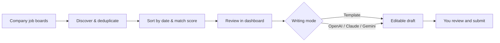

# 🚀 JobPilot AI

### Find great jobs. See the newest first. Apply with confidence.


**JobPilot AI** is a beginner-friendly, open-source job hunter for DevOps, SRE, Cloud and Platform Engineering roles. It discovers roles on company career pages, sorts by the newest available dates, highlights the best matches, and helps you prepare applications. **You always approve and submit each application yourself.**

> No API key? No problem. The Standard edition searches public job boards and creates editable application templates. Multi-AI is optional.

## 🧩 How it works



## ✨ Features

| Feature | Standard | Multi-AI |
|---|:---:|:---:|
| Search public Ashby, Greenhouse & Lever boards | ✅ | ✅ |
| Optional Google X-Ray discovery via Serper | ✅ | ✅ |
| Newest-first with clearly labeled dates | ✅ | ✅ |
| Rank jobs by skills, title and location | ✅ | ✅ |
| Save, skip and track applications locally | ✅ | ✅ |
| Editable application answer templates | ✅ | ✅ |
| Generate tailored text using OpenAI | — | ✅ |
| Generate tailored text using Claude | — | ✅ |
| Generate tailored text using Gemini | — | ✅ |
| Choose provider, model and API key in sidebar | — | ✅ |
| Optional visible-browser autofill | ✅ | ✅ |
| Manual review before final application | ✅ | ✅ |

## 📦 Get JobPilot AI

**Option A: Download (easiest)**

1. On GitHub, click the green **Code** button → **Download ZIP**.
2. Extract the ZIP and open the `jobpilot-ai` folder.
3. Open Terminal (Mac/Linux) or Command Prompt (Windows) in that folder.
4. Follow the launch steps below.

**Option B: Clone using Git**

```bash
git clone https://github.com/Chirag0401/jobpilot-ai.git
cd jobpilot-ai
```

## ▶️ Run in two steps

Install **Python 3.10+** first. Then choose **one** edition:

| Edition | macOS / Linux | Windows |
|---|---|---|
| **Standard** (no AI key needed) | `./start.sh` | `start.bat` |
| **Multi-AI** (choose a model provider) | `./start-multi-ai.sh` | `start-multi-ai.bat` |

On Mac/Linux, if you see a permission error, run:

```bash
chmod +x start.sh start-multi-ai.sh
```

The launch script creates a virtual environment, installs required Python packages, creates `.env` if missing, and starts the Streamlit dashboard. Open the address shown in Terminal (usually **http://localhost:8501**).

**Already using the previous version?** Back up your `.env`, `config.yaml`, and `jobpilot.sqlite3` before replacing the folder, then restore your settings. The database schema is unchanged.

## 🌍 Share or contribute

You are viewing the official **[JobPilot AI repository](https://github.com/Chirag0401/jobpilot-ai)**. Share this link, choose **Code → Download ZIP**, or clone using the command above.

To publish your own customized copy, click GitHub's **Fork** button. To suggest improvements, read [CONTRIBUTING.md](CONTRIBUTING.md) and open a pull request.

## 🧠 Using Multi-AI: OpenAI, Claude, or Gemini

1. Start using **`./start-multi-ai.sh`** (or the Windows `.bat` launcher).
2. In the **left sidebar**, choose **Template**, **OpenAI**, **Claude**, or **Gemini**.
3. If using AI, paste an API key into the password field, **or** save it once in `.env`.
4. Choose or edit the model name (defaults provided).
5. Select a job → **Application desk** → **Generate tailored draft**.
6. **Review and edit** the result before sending it anywhere.

You only need an API key from **the provider you choose**. No AI key is needed for job search or tracking.

```dotenv
# Copy .env.example to .env and fill in ONLY what you need:
OPENAI_API_KEY=
ANTHROPIC_API_KEY=
GEMINI_API_KEY=
SERPER_API_KEY=
```

| Provider | Where to get a key | Example model |
|---|---|---|
| OpenAI | https://platform.openai.com/api-keys | `gpt-4.1-mini` |
| Claude (Anthropic) | https://console.anthropic.com/settings/keys | `claude-sonnet-4-5` |
| Gemini (Google) | https://aistudio.google.com/apikey | `gemini-2.5-flash` |

Model availability changes; if a default model is unavailable for your account, select an available ID. **ChatGPT Plus, Claude Pro and Gemini subscriptions do not automatically include paid API usage.** Provider API billing is separate. API requests use providers' official HTTPS endpoints.

## 🔎 Search for jobs

1. Open the dashboard.
2. Click **Scan now** in the sidebar.
3. Browse by fit score, posted/updated date and location.
4. Open the official job link to verify it is still open.
5. Save, skip, approve, or mark as applied **only after submitting yourself**.

**Without a Serper key:** searches the public company boards listed in `config.yaml`.

**With a Serper key:** uses these four Google X-Ray discovery patterns automatically:

```text
site:jobs.ashbyhq.com ("DevOps Engineer" OR "SRE" OR "Platform Engineer") ("India" OR "Remote")
site:job-boards.greenhouse.io ("DevOps" OR "Platform Engineer") "India"
site:jobs.lever.co ("DevOps Engineer" OR "SRE") ("Mumbai" OR "Remote")
("OpenShift" OR "OCP") ("DevOps" OR "Platform Engineer") "India" jobs
```

The match score is **a keyword relevance score**, not the probability of getting hired. Dates mean different things across job sites (original publish, last publish, or update); the dashboard labels them. Date-unknown jobs appear last.

## ⚙️ Make the results yours

Open **`config.yaml`** and edit these fields:

- `profile.verified_experience`: **your actual skills** (examples are placeholders; replace them).
- `preferences.preferred_cities`: e.g., Mumbai, Pune, Bengaluru.
- `preferences.technology_terms`: e.g., AWS, Kubernetes, OpenShift, Terraform.
- `preferences.max_age_days`: e.g., `7` for recent dated jobs.
- `boards`: add company boards you like.

Never put your email, resume, or API keys in `config.yaml` if you plan to share it publicly.

## 📁 Project structure

```text
jobpilot-ai/
├── dashboard.py                 # Easy-to-use web dashboard
├── scout.py                     # Discover, score and track jobs
├── ai_providers.py              # OpenAI / Claude / Gemini API calls
├── autofill.py                  # OPTIONAL browser helper (no submission)
├── config.yaml                  # Customizable search and skill preferences
├── .env.example                 # API key placeholders (no actual secrets)
├── start.sh / start.bat          # Standard edition launchers
├── start-multi-ai.sh / .bat      # Multi-AI edition launchers
├── publish-to-github.sh         # Optional standalone publishing helper
├── requirements.txt             # Common dependencies
├── requirements-browser.txt     # Optional Playwright dependency
├── requirements-dev.txt         # Test dependencies
├── tests/                       # Offline automated tests
└── .github/workflows/           # Tests and optional daily scans
```

## 🕗 Daily scans (optional)

The GitHub Actions workflow (`.github/workflows/daily-scan.yml`) runs approximately **8:00 AM India time**, or on demand. It uploads JSON scan results as an Actions artifact. It does not send notifications, save to your laptop database, or submit applications. You can configure `SERPER_API_KEY` as a **repository secret**.

## 🖱️ Optional assisted browser filling

```bash
pip install -r requirements-browser.txt
playwright install chromium
cp profile_private.example.json profile_private.json
# Edit the PRIVATE profile file with real values and an absolute resume path.
python autofill.py --url 'https://jobs.lever.co/company/job-id/apply'
```

This assists with common fields on supported job boards, but it does **not** bypass CAPTCHA or click Submit. Different employers use different forms; verify everything before applying.

## 🧪 Tests

```bash
pip install -r requirements-dev.txt
pytest -q
```

Tests use mocked API responses and do not need provider keys or live vacancies.

## 🔐 Privacy, limitations and ethics

JobPilot is **local-first**. The job tracker uses a local SQLite file. The scanner only reads public job information. AI draft generation sends job content and your optional resume text **to the provider you select**, so do not include confidential employer/client information. Keys entered in the Streamlit sidebar are session-only; `.env` is Git-ignored.

This is **not an unattended application bot**. Form submission, CAPTCHA handling, complex custom questions and tracking job board changes all require careful per-site handling. Do not infer that opening a link means you've applied.

**Do not publish this app to the open web without adding authentication, secret management, and hosted persistent storage.** A public Streamlit dashboard with application data is not a safe multi-user deployment.

## 🧭 Roadmap

- [x] Public ATS search, Google X-Ray, newest-first matching
- [x] Application tracker and review-first drafts
- [x] OpenAI, Claude and Gemini support
- [ ] Persistent user accounts and cloud database
- [ ] Alerts for newly discovered jobs
- [ ] PDF/DOCX resume parsing with consent
- [ ] Employer-specific, user-approved submission adapters
- [ ] Hosted multi-user web app and exportable application history

## 🤝 Contribute

Ideas and PRs are welcome. See [CONTRIBUTING.md](CONTRIBUTING.md) and [SECURITY.md](SECURITY.md). This project is licensed under the [MIT License](LICENSE).

---

*Built for job seekers. Keep the human in control.*
