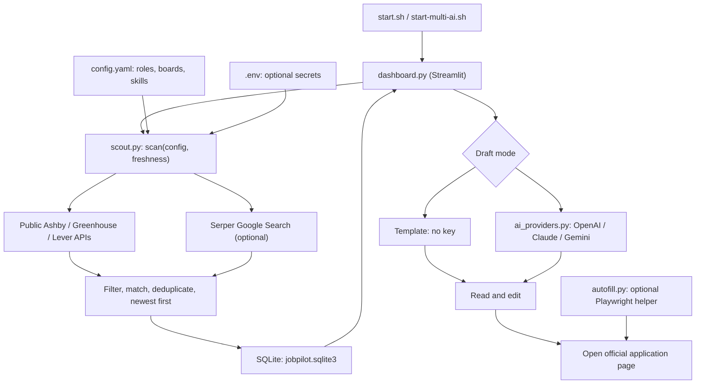

# 📖 JobPilot AI — Codebase Walkthrough

This is a guided tour of **the code that exists in this repository**, rather than a proposal for a future architecture. No cloud account or API key is required to read or test it.

## 1. The big picture



**Remember:** JobPilot discovers jobs and prepares application text; it does **not** press the final application submit button.

## 2. First files to read (in this order)

| File | Why it exists | What to look for |
|---|---|---|
| `start.sh` / `start-multi-ai.sh` | Starts the app in a local Python virtual environment | `JOBPILOT_EDITION`, `streamlit run dashboard.py` |
| `dashboard.py` | The Streamlit interface | Sidebar, **Scan now**, **Newest jobs**, **Application desk** |
| `config.yaml` | Editable public defaults | Boards, preferred cities, technologies, experience examples |
| `scout.py` | Job discovery, matching, deduplication, SQLite | `scan()`, `score_job()`, `persist_jobs()` |
| `ai_providers.py` | Calls one chosen AI API for a draft | `generate_application_draft()` |
| `autofill.py` | Optional visible browser form helper | `main()`, `best_effort_fill()` |
| `tests/` | Offline regression checks | Mocked ATS and AI API responses |
| `.github/workflows/` | Tests and optional scheduled job scans | `tests.yml`, `daily-scan.yml` |

## 3. What happens when you click "Scan now"?

1. `dashboard.py` reads public settings with `load_config()`.
2. The sidebar button calls `scan(config, freshness)` from `scout.py`.
3. `discover_serper()` optionally runs the four Google X-Ray search queries if `SERPER_API_KEY` is set; otherwise it only uses configured company boards.
4. `fetch_ashby()`, `fetch_greenhouse()`, and `fetch_lever()` request publicly listed jobs from those services' public job-board feeds.
5. `score_job()` filters by title, seniority, location and matching technologies. This is a **keyword heuristic**, not an LLM assessment or hiring-probability estimate.
6. `scan()` removes duplicates, filters older **dated** jobs according to `max_age_days`, and calls `newest_first()`. Unknown dates are shown after dated roles.
7. `persist_jobs()` writes the results into the local SQLite file `jobpilot.sqlite3`, preserving tracked application status.

**Important date detail:** Ashby last-published, Greenhouse first-published (or update fallback), and Lever creation timestamps are different concepts. A Google result filtered to "past day" doesn't prove the job was posted that day.

### Trace these functions in `scout.py`

```python
scan(config, freshness_override)     # orchestrates job discovery
discover_serper(config, freshness)    # optional search discovery
fetch_ashby(board)                    # Ashby public feed
fetch_greenhouse(board)               # Greenhouse public feed
fetch_lever(board)                    # Lever public feed
score_job(job, preferences)           # title + tech + location heuristic
newest_first(jobs)                    # sorts by available ATS timestamp
persist_jobs(conn, jobs)              # saves rows in SQLite
```

## 4. What happens when you generate an AI answer?

`dashboard.py` sends the selected job, optional uploaded `.txt/.md` resume text, and chosen provider to `scout.ai_draft()`.

- **Template:** `draft_template()` returns editable placeholder text; no AI API key is needed.
- **OpenAI, Claude or Gemini:** `ai_providers.generate_application_draft()` checks the selected provider's key, prepares a short prompt using **verified skills from `config.yaml`**, sends one HTTPS request to the respective provider, and extracts the response text.
- The resulting draft can be edited and saved to SQLite. **Nothing automatically submits it to an employer.**

The code uses `requests` directly for the three provider APIs; it does **not** require the providers' Python SDKs. Provider API keys live in your ignored local `.env` file or in the Streamlit session (when entered in the sidebar). A resume's contents are sent to the selected model provider when you request a draft—avoid employer-confidential information.

## 5. Where is application history stored?

`scout.connect_db()` creates a **SQLite** database called `jobpilot.sqlite3` on your computer. `persist_jobs()`, `set_status()`, and `save_draft()` manage job data, stages and answer drafts. The status labels include `new`, `saved`, `approved`, `applied`, and `rejected`. The app does not independently verify applications marked "applied".

## 6. Is `autofill.py` the application agent?

Not yet. This helper opens a **visible Chromium window** using Playwright, fills some common personal information fields and may attach a locally referenced resume. You still handle custom questions, CAPTCHA, consent, and the final **Submit** action. Only configured ATS domains are allowed by the helper.

## 7. Try it locally

```bash
git clone https://github.com/Chirag0401/jobpilot-ai.git
cd jobpilot-ai

# Mac / Linux: Multi-AI dashboard (also works with Template mode)
chmod +x start-multi-ai.sh
./start-multi-ai.sh
```

On Windows, use `start-multi-ai.bat`.

Edit `config.yaml` to match your own verified experience and preferred locations. To add optional API keys, copy `.env.example` to `.env` and paste only the keys you plan to use. **Do not push `.env` or private resumes to GitHub.**

For command-line job discovery (after installing requirements):

```bash
python scout.py scan --freshness day --output results/today.json
```

For offline tests:

```bash
python -m pip install -r requirements-dev.txt
pytest -q
```

No key is needed for the mocked tests. The GitHub Actions daily scan uploads a JSON artifact; it **does not notify you or sync with the local database**.

## 8. Things to improve in future contributions

These are observations from the **current implementation**:

1. `preferences.role_terms` is present in `config.yaml`, but `role_match()` currently uses a **hardcoded** list instead. Make the title filter use the configuration.
2. `preferences.allow_remote_india` is also defined in `config.yaml`, but `location_check()` does **not currently enforce** this toggle. Add a test for both settings.
3. The match score is keyword-based; it doesn't yet measure genuine experience depth, must-have requirements, salary, or work authorization.
4. No hosted multi-user authentication, private-user storage, first-class email notifications, or automatic application submission has been implemented.
5. Public feed availability and third-party model IDs may change; tests mock providers, so a successful unit test is **not** proof that a live API key or job board currently works.

### A good first pull request

Make `role_match()` use the `role_terms` setting while preserving a sensible fallback, add parameterized tests, and run `pytest -q`. It is a small, self-contained contribution and a great way to learn the project's flow.
